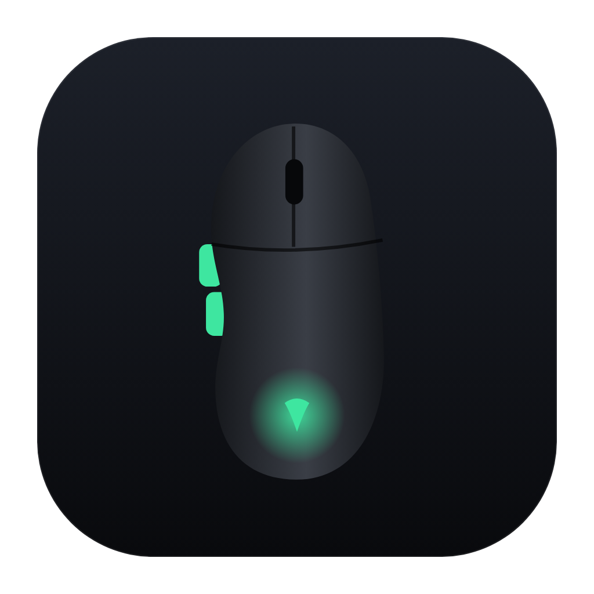
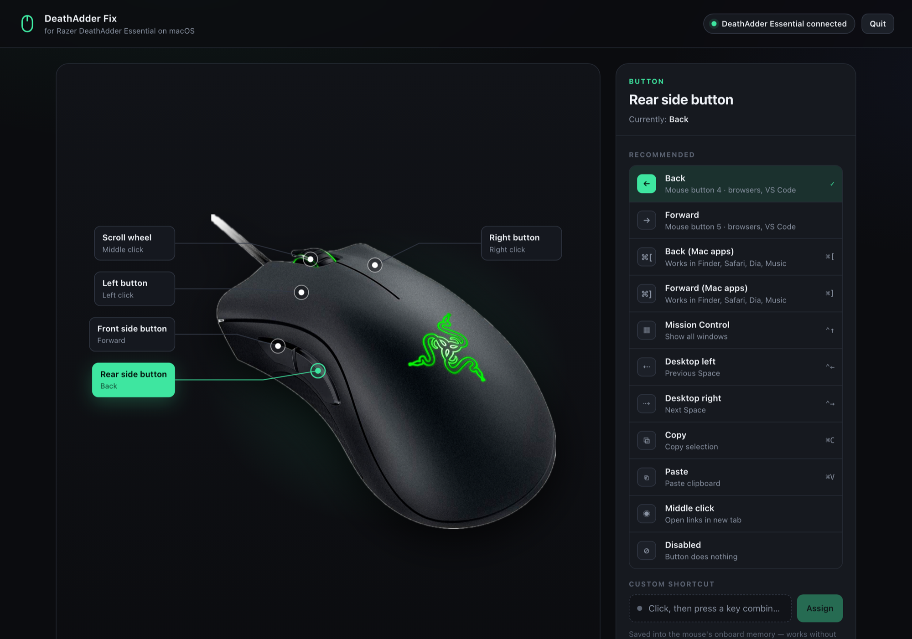

<div align="center">



# DeathAdder Fix

**Make the side buttons of a Razer DeathAdder Essential work on macOS, and remap them to any shortcut.**

No Synapse, no kernel extension, no background daemon. Settings are written to the mouse's own memory.

   



</div>

---

## The problem

You plug a **Razer DeathAdder Essential** into a Mac (or a Linux box) and the two side buttons do **nothing**: not in Safari, not in Chrome, not in Finder. Karabiner-Elements and other remappers see no events either. Yet the same mouse works perfectly on Windows.

### Why it happens

The DeathAdder Essential stores each button's action in **onboard memory**. If the mouse has ever been configured with **Razer Synapse on Windows**, the side buttons can be left with the action `disabled` (`00`) in that memory, while Synapse quietly provides back/forward in software. On Windows, Synapse covers it up. On macOS and Linux, where there is no Synapse, the mouse simply never sends button 4 or button 5.

This was confirmed by reading the mouse directly:

| Button | Onboard action (before) | Meaning |
|---|---|---|
| Left / Right / Wheel | `01 01 01` / `01 01 02` / `01 01 03` | mouse button 1–3 ✓ |
| **Rear side** | **`00`** | **disabled** ✗ |
| **Front side** | **`00`** | **disabled** ✗ |

No macOS setting, driver, or remapper can fix this, because the signal never leaves the mouse. **DeathAdder Fix rewrites the onboard action** back to mouse button 4/5, or to any keyboard shortcut you choose.

## Features

- **One-click fix:** restores the side buttons to Back / Forward.
- **Remap the side buttons and the wheel click** to:
  - Back / Forward (mouse buttons 4/5, used by browsers and VS Code)
  - **⌘[ / ⌘]**, i.e. Back / Forward in **Finder, Safari, Music** and other native Mac apps that ignore mouse button 4/5
  - Mission Control, switching Spaces, Copy / Paste, Middle click, Disabled
  - **Any key combination** you record (⌘ ⌥ ⌃ ⇧ + letters, digits, F-keys, arrows, and more)
- **Stored on the mouse:** it works without the app running, after reboots, and on other computers.
- **Live tester:** press any button and watch it light up.
- **Polished local UI:** click any button on the mouse photo to configure it.
- **Safe by design:**
  - Left and right click can't be remapped, so you can't lock yourself out.
  - The UI is served only on `127.0.0.1` and protected by a per-launch token.
- **No permissions prompts:** it talks to the mouse's control channel, which doesn't need Input Monitoring.
- **CLI included** for scripting.

## Install

### Option A: download the app

1. Download **`DeathAdder Fix.dmg`** from the [latest release](../../releases/latest).
2. Open it and drag **DeathAdder Fix** onto **Applications**.
3. The first time, **right-click → Open** (the app is ad-hoc signed, not notarised).
4. Your browser opens the DeathAdder Fix page. Click **Fix side buttons**, or pick any action.

To quit, click **Quit** in the top-right corner. Your settings stay on the mouse.

### Option B: build from source

Requires the Xcode Command Line Tools (`xcode-select --install`).

```bash
git clone https://github.com/aknahin/mac-razer-deathadder-essential-fix.git
cd mac-razer-deathadder-essential-fix
./scripts/build-app.sh          # → dist/DeathAdder Fix.app, .dmg and .zip (universal)
open "dist/DeathAdder Fix.app"
```

Or run it straight from the source tree:

```bash
swift run deathadder-fix        # opens the web UI
```

## Command line

```text
deathadder-fix                      Open the web UI (same as `serve`)
deathadder-fix serve [--port N] [--no-open]
deathadder-fix status               Firmware, mode and every button's assignment
deathadder-fix fix                  Restore the side buttons to Back / Forward
deathadder-fix set <button> <action>
      button:  back | forward | middle
      action:  default | disabled | mouse4 | mouse5 | <shortcut>
deathadder-fix reset                Factory defaults on all buttons
```

Examples:

```bash
$ deathadder-fix status
Razer DeathAdder Essential
  firmware   1.0
  mode       normal
  left       Left click
  right      Right click
  middle     Middle click
  back       Disabled
  forward    Disabled

$ deathadder-fix fix
✓ Side buttons restored to Back / Forward.

$ deathadder-fix set back cmd+[        # Back in Finder & Safari too
$ deathadder-fix set forward cmd+]
$ deathadder-fix set middle ctrl+up    # Mission Control
```

## How it works

Razer mice expose a vendor control channel: a **90-byte HID feature report** on the mouse interface. DeathAdder Fix opens it with IOKit and speaks the same protocol that Synapse (and the open-source [OpenRazer](https://github.com/openrazer/openrazer) project) uses.

```
byte  0     status            00 request · 02 OK · 01 busy · 03 fail · 05 unsupported
byte  1     transaction id    0x1f for the DeathAdder Essential
bytes 2–4   remaining packets / protocol type (0)
byte  5     data size
byte  6–7   command class / command id
bytes 8–87  arguments
byte  88    CRC = XOR of bytes 2…87
```

| Command | Class / ID | Arguments |
|---|---|---|
| Firmware version | `00 / 81` | — |
| Device mode (normal / driver) | `00 / 84` | — |
| **Get button action** | `02 / 8c` | `profile, button, 0` |
| **Set button action** | `02 / 0c` | `profile, button, 0, type, size, params…` |

Button actions:

| Encoding | Action |
|---|---|
| `00` | disabled |
| `01 01 N` | mouse button *N* (1 = left … 4 = back, 5 = forward) |
| `02 02 M K` | keyboard key: modifier bits *M* (⌃ 1 · ⇧ 2 · ⌥ 4 · ⌘ 8) + HID usage *K* |

Every change is written to both onboard profiles and then read back.

### Architecture

```
DeathAdder Fix.app
├── deathadder-fix (Swift, no dependencies)
│   ├── RazerKit        packet/CRC, IOKit transport, button actions, shortcut parser
│   └── WebServer       127.0.0.1-only HTTP + JSON API, per-launch token
└── Resources/Web       index.html · app.css · app.js (vanilla, no build step)
```

**Why not a pure web app?** The control channel sits inside the mouse's HID collection, and browsers' WebHID deliberately blocks mouse and keyboard devices. A tiny native helper is the only way to reach it. The UI is still just a web page.

## Troubleshooting

| Symptom | Fix |
|---|---|
| "Mouse not connected" | Unplug and replug the mouse. Try a different hub port. Check that `system_profiler SPUSBDataType` lists *Razer DeathAdder Essential*. |
| The buttons broke again after using a Windows PC | Synapse rewrote the onboard memory. Click **Fix side buttons** again, or in Synapse set the buttons to *Mouse Button 4 / 5*. |
| Back works in Chrome or Dia but not in Finder or Safari | Native Mac apps ignore mouse buttons 4/5. Assign **Back (Mac apps) ⌘[** / **Forward (Mac apps) ⌘]** instead. |
| Karabiner-Elements rules for the mouse do nothing | If Karabiner is set to ignore the device, or lacks Input Monitoring, its rules won't apply. With DeathAdder Fix you usually don't need Karabiner at all. |
| "App can't be opened" | Right-click the app → **Open**, or run `xattr -dr com.apple.quarantine "/Applications/DeathAdder Fix.app"`. |

## Development

```bash
swift build
swift test                       # packet layout, CRC, encoding, shortcut parsing
swift run deathadder-fix status  # talks to the real mouse
```

Only the **DeathAdder Essential (USB `1532:0098`)** has been tested. Other Razer mice use the same protocol, but their button ids and transaction id may differ. PRs are welcome.

## Disclaimer

This project is **not affiliated with, endorsed by, or sponsored by Razer Inc.** "Razer", "DeathAdder" and the Razer logo are trademarks of Razer Inc. The product photo is © Razer Inc. Both are used here only to identify the supported hardware. DeathAdder Fix writes to your mouse's onboard memory at your own risk. Everything it changes can be undone with **Reset all to defaults**.

## License

[MIT](LICENSE) © 2026 aknahin
